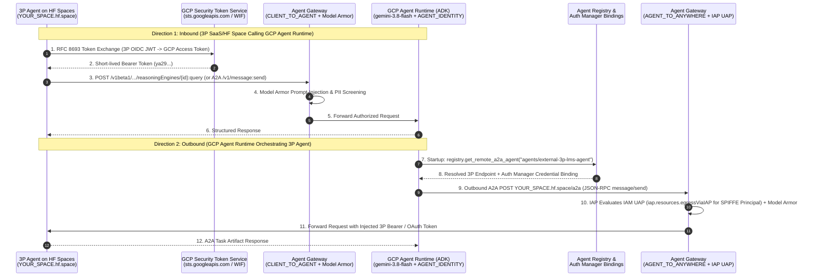

# Demo 01: Cross-Platform 3P Agent <-> GCP Agent Runtime Interoperability

This reference implementation demonstrates end-to-end, bidirectional interoperability between an **external third-party (3P) agent** hosted outside Google Cloud and an **ADK orchestrator agent** hosted on **Google Cloud Agent Runtime (`reasoningEngines`)**, using **Terraform**, **ADK (`gemini-3.8-flash`)**, **A2A over HTTP+JSON**, **IAM Workload Identity Federation (WIF)**, **Agent Registry**, **Agent Identity Auth Manager**, and **dual-mode Agent Gateway (`CLIENT_TO_AGENT` + `AGENT_TO_ANYWHERE`)**.

---

## 1. Why Hugging Face Spaces (Docker) + OIDC WIF for the 3P Platform?

In enterprise architectures, the external 3P agent often lives inside a SaaS platform such as Blackboard / Anthology (LMS), ServiceNow, Salesforce, or Workday. For a self-contained, reproducible engineering demo that you can spin up from your browser in under 3 minutes without enterprise SaaS licensing or credit cards, this blueprint uses **Hugging Face Spaces (Docker SDK)** as the external 3P runtime:

1. **Instant Public HTTPS Endpoint (`https://<owner>-<space>.hf.space`):** Free, browser-provisioned Docker container runtime on port `7860` with built-in secret management.
2. **Standards-Compliant A2A Server (Direction 2 — Outbound Target):** Serves `GET /.well-known/agent-card.json` and `POST /a2a` (`message/send` over JSON-RPC 2.0), protected by Bearer/OAuth authentication brokered by **GCP Agent Identity Auth Manager** (`google_agent_registry_binding`).
3. **Built-In OIDC Issuer + JWKS Server (Direction 1 — Inbound Caller):** Because Hugging Face Spaces serves traffic over public HTTPS, the 3P container also exposes `GET /.well-known/openid-configuration` and `GET /.well-known/jwks.json` (plus supports offline `jwks_json` pinning in Terraform). When triggered via `POST /delegate-to-gcp`, the 3P agent mints a short-lived RS256 OIDC JWT, exchanges it at Google's Security Token Service (`https://sts.googleapis.com/v1/token`, RFC 8693) via **IAM Workload Identity Federation**, and invokes the GCP Agent Runtime instance with **zero static GCP service account keys**.
4. **Bonus GitHub Actions OIDC Option:** You can also point the Terraform `wif_issuer_uri` to the GitHub Actions OIDC issuer (`https://token.actions.githubusercontent.com/.well-known/openid-configuration`, trimming the `/.well-known/openid-configuration` suffix) to test inbound WIF directly from a GitHub Actions workflow.

---

## 2. Architecture & Operational Separation of Duties

The single most important architectural distinction in Gemini Enterprise Agent Platform is **what Agent Registry governs** versus **what governs live wire traffic**:

| Plane / Direction | Component | Operational Role |
| :--- | :--- | :--- |
| **Control Plane (Catalog & Discovery)** | **Agent Registry** (`google_agent_registry_service`) | Tracks the external 3P agent (`agents/<id>`), indexes its A2A skills from its Agent Card, allows ADK orchestrators to dynamically resolve its URL at startup, and serves as the destination identifier for outbound IAM UAP rules. **Not evaluated on inbound (`CLIENT_TO_AGENT`) traffic.** |
| **Direction 1: Inbound (`3P -> GCP Agent Runtime`)** | **IAM WIF** + **Agent Gateway (`CLIENT_TO_AGENT`)** + **Model Armor** | 3P agent exchanges its native OIDC JWT at `sts.googleapis.com` for a short-lived GCP Bearer token (`roles/aiplatform.user`). `CLIENT_TO_AGENT` Agent Gateway intercepts inbound calls to `reasoningEngines`, runs Model Armor prompt-injection/DLP screening, and forwards to Agent Runtime. |
| **Direction 2: Outbound (`GCP Agent Runtime -> 3P`)** | **Agent Identity (`SPIFFE`)** + **Auth Manager Binding** + **Agent Gateway (`AGENT_TO_ANYWHERE`)** + **IAM UAP** | Agent Runtime runs with `identity_type = "AGENT_IDENTITY"` (`principal://agents.global.org-ORG_ID.system.id.goog/...`), resolves the 3P agent from Agent Registry, attaches 3P credentials via `google_agent_registry_binding`, and egresses through `AGENT_TO_ANYWHERE` Agent Gateway where IAP enforces `iap.googleapis.com/resources.egressViaIAP` via IAM Unified Access Policies (UAP). |



---

## 3. End-to-End Walkthrough (Browser + Terraform + ADK)

### Step 1: Spin Up the External 3P Agent in Your Browser (Hugging Face Spaces)

1. Open [https://huggingface.co/spaces](https://huggingface.co/spaces) in your Cloudtop Chrome browser and click **New Space**.
2. Set:
   - **Space name:** `external-a2a-lms-agent`
   - **License:** `apache-2.0`
   - **Select the Space SDK:** **Docker** -> **Blank**
   - **Visibility:** **Public** (required so GCP WIF and Agent Runtime can reach the HTTPS endpoint without Hugging Face platform login cookies; the `/a2a` endpoint itself enforces `Authorization: Bearer <A2A_INBOUND_TOKEN>`).
3. Clone or push the files in [`external_3p_agent/`](./external_3p_agent/) (`README.md`, `Dockerfile`, `app.py`, `requirements.txt`, `.dockerignore`) to your new Space repository.
4. Generate an RSA keypair locally for the 3P OIDC Issuer (so the JWKS stays stable across container restarts) and a shared Bearer token for Direction 2:
   ```bash
   python3 scripts/test_inbound_wif_to_gcp.py --generate-keys-only --out-dir /tmp/3p_oidc_keys
   ```
   This prints:
   - `A2A_INBOUND_TOKEN`: Secret token that the 3P `/a2a` endpoint requires from callers (stored in GCP Agent Identity Auth Manager).
   - `OIDC_PRIVATE_KEY_B64`: Base64-encoded RSA private key configured as a Secret in your Hugging Face Space.
   - `jwks.json`: Public JWKS JSON (also served automatically at `https://<your-hf-space>.hf.space/.well-known/jwks.json`).
5. In your Hugging Face Space UI, go to **Settings -> Variables and secrets**:
   - Add Secret `A2A_INBOUND_TOKEN` = `<generated-token>`
   - Add Secret `OIDC_PRIVATE_KEY_B64` = `<generated-base64-private-key>`
   - Add Variable `PUBLIC_ISSUER_URL` = `https://<your-username>-external-a2a-lms-agent.hf.space`
6. Verify your live 3P agent in the browser or terminal:
   ```bash
   export EXT_3P_URL="https://<your-username>-external-a2a-lms-agent.hf.space"
   curl -sS "$EXT_3P_URL/.well-known/agent-card.json" | jq .
   curl -sS "$EXT_3P_URL/.well-known/openid-configuration" | jq .
   ```

### Step 2: Provision the GCP Governance & Identity Stack via Terraform

```bash
cd terraform
cp terraform.tfvars.example terraform.tfvars
# Edit terraform.tfvars with your project_id, organization_id, and external_3p_agent_url
terraform init
terraform plan
terraform apply
```

What [`terraform/main.tf`](./terraform/main.tf) provisions:
- **APIs & Service Identities:** Enables `aiplatform.googleapis.com`, `agentregistry.googleapis.com`, `networkservices.googleapis.com`, `networksecurity.googleapis.com`, `modelarmor.googleapis.com`, `iap.googleapis.com`, `iam.googleapis.com`, and `sts.googleapis.com`.
- **Direction 1 (Inbound WIF):**
  - `google_iam_workload_identity_pool.external_3p_pool`
  - `google_iam_workload_identity_pool_provider.external_3p_oidc` (trusts your 3P `issuer_uri` and maps `google.subject = assertion.sub`)
  - Least-privilege IAM binding granting the federated `principal://iam.googleapis.com/projects/.../workloadIdentityPools/.../subject/agent:external-3p-lms-agent` permission to invoke Agent Runtime (`roles/aiplatform.user`).
- **Direction 2 (Outbound Agent Registry + Auth Manager):**
  - `google_agent_registry_service.external_3p_agent`: Registers the 3P agent and its `A2A_AGENT_CARD` in Agent Registry (`agents/external-3p-lms-agent`).
  - `google_agent_identity_auth_provider.external_3p_auth`: Stores the 3P API key / Bearer credential (`or 2LO OAuth config`) in Agent Identity Auth Manager.
  - `google_agent_registry_binding.external_3p_binding`: Links the GCP orchestrator agent to the 3P target and Auth Provider.
- **Dual-Mode Agent Gateway + Model Armor + IAP UAP (Optional via `enable_agent_gateway = true`):**
  - `google_network_services_agent_gateway.ingress_client_to_agent` (`CLIENT_TO_AGENT`)
  - `google_network_services_agent_gateway.egress_agent_to_anywhere` (`AGENT_TO_ANYWHERE`)
  - `google_model_armor_template.agent_safety_guardrails`
  - `google_network_security_authz_policy.egress_essential_gcp_hosts` (allowlists `aiplatform`, `agentregistry`, `logging`, and `.mtls.googleapis.com` endpoints so the container does not lock itself out with HTTP 498!)
  - `google_iam_project_access_policy.agent_egress_uap` + `google_iam_projects_policy_binding.agent_egress_uap_binding` granting `iap.googleapis.com/resources.egressViaIAP` to the Agent Runtime SPIFFE `principalSet://agents.global.org-ORG_ID.system.id.goog/...`.

### Step 3: Deploy the ADK Orchestrator to GCP Agent Runtime

```bash
python3 -m venv .venv
source .venv/bin/activate
pip install -r gcp_agent_runtime/requirements.txt

export GOOGLE_CLOUD_PROJECT="YOUR_PROJECT_ID"
export GOOGLE_CLOUD_LOCATION="us-central1"
export STAGING_BUCKET="gs://YOUR_PROJECT_ID-agent-runtime-staging"
export EXTERNAL_AGENT_REGISTRY_ID="external-3p-lms-agent"

python3 gcp_agent_runtime/deploy_agent_engine.py \
  --project "$GOOGLE_CLOUD_PROJECT" \
  --location "$GOOGLE_CLOUD_LOCATION" \
  --staging-bucket "$STAGING_BUCKET"
```

### Step 4: Test Both Directions End-to-End

1. **Test Direction 1 (Inbound: 3P Agent -> WIF STS Token Exchange -> GCP Agent Runtime):**
   ```bash
   python3 scripts/test_inbound_wif_to_gcp.py \
     --three-p-url "$EXT_3P_URL" \
     --wif-provider "$(terraform -chdir=terraform output -raw wif_provider_resource_name)" \
     --reasoning-engine "$(cat /tmp/deployed_reasoning_engine.txt)"
   ```
2. **Test Direction 2 (Outbound: GCP Agent Runtime -> Agent Registry + Auth Manager -> 3P Agent):**
   ```bash
   python3 scripts/test_outbound_gcp_to_3p.py \
     --project "$GOOGLE_CLOUD_PROJECT" \
     --location "$GOOGLE_CLOUD_LOCATION" \
     --reasoning-engine "$(cat /tmp/deployed_reasoning_engine.txt)"
   ```

---

## 4. Ten Critical Nuances & Day-2 Operational Gotchas

### Gotcha 1: Agent Registry Is Not an Inbound Firewall
Registering a 3P agent in **Agent Registry** (`google_agent_registry_service`) makes it discoverable for **outbound** calls from GCP and allows you to reference it in outbound IAM Unified Access Policies (`destination.agent_registry.agent.name`). It **does not** authenticate or authorize inbound calls from that 3P agent into GCP. Inbound calls must authenticate via **IAM Workload Identity Federation (WIF)** and IAM roles (`roles/aiplatform.user` or `aiplatform.reasoningEngines.query`).

### Gotcha 2: Avoiding the `HTTP 498` Default-Deny Lockout on Egress Gateways
The moment you bind a `reasoningEngine` instance to an enforcing `AGENT_TO_ANYWHERE` Agent Gateway, **all outbound container traffic** routes through the gateway—including calls to Vertex AI (`aiplatform.googleapis.com`), Sessions, Memory Bank, Cloud Logging (`logging.googleapis.com`), and `agentregistry.googleapis.com`.
- **Nuance:** Google API client libraries inside Agent Runtime frequently negotiate **mTLS** and connect to `*.mtls.googleapis.com` (for example, `us-central1-aiplatform.mtls.googleapis.com` and `cloudresourcemanager.mtls.googleapis.com`).
- **Wildcards are not supported** in `google_network_security_authz_policy` host lists; you must explicitly list both the standard and `.mtls.googleapis.com` hostnames (included in [`terraform/main.tf`](./terraform/main.tf)), and always start IAP in **Dry-Run (Audit-only)** mode before enforcing.

### Gotcha 3: Org Policy `constraints/iam.managed.disableAccessPolicyBindings` Blocks IAM UAPs
By default in many Google Cloud organizations, the boolean constraint `constraints/iam.managed.disableAccessPolicyBindings` is **enabled**, which blocks binding IAM v3 Unified Access Policies (`google_iam_projects_policy_binding`) to projects for `AGENT_TO_ANYWHERE` egress governance. You must disable enforcement of this constraint on your project/folder before applying UAP bindings.

### Gotcha 4: One Agent Gateway Pair per Project + Region (and the April 29, 2026 Cutoff)
- All `reasoningEngine` instances deployed in the same GCP project and region must bind to the **same** `CLIENT_TO_AGENT` ingress gateway and the **same** `AGENT_TO_ANYWHERE` egress gateway.
- Reasoning Engines created prior to **April 29, 2026** cannot be bound to an Agent Gateway in-place; they must be redeployed with `identity_type = "AGENT_IDENTITY"`.

### Gotcha 5: Agent Runtime Does Not Serve an Unauthenticated Public Agent Card
Unlike standalone public A2A servers that expose `/.well-known/agent-card.json` anonymously, Agent Runtime (`.../reasoningEngines/{id}/v1/card`) requires a valid `Authorization: Bearer <google-access-token>` header even to fetch the Agent Card. The 3P caller must complete the WIF STS token exchange **before** fetching `/v1/card` or calling `/v1/message:send`.

### Gotcha 6: `CLIENT_TO_AGENT` Gateway Coverage (`query` / `streamQuery` vs. `asyncQuery`)
`CLIENT_TO_AGENT` Agent Gateway currently governs synchronous `query` and `streamQuery` invocations on Agent Runtime (not `asyncQuery`). Furthermore, `CLIENT_TO_AGENT` mode is supported for **Agent Runtime**, whereas **Gemini Enterprise** apps currently support `AGENT_TO_ANYWHERE` (egress) mode.

### Gotcha 7: BYOC Custom Container CA Trust for Egress TLS Inspection
When you deploy an agent from source (`ReasoningEngine.create` / `inline_source`), Agent Runtime automatically injects and trusts Agent Gateway's TLS-inspection root CA. If you deploy a **Bring-Your-Own-Container (BYOC)** image bound to an `AGENT_TO_ANYWHERE` gateway, your container's HTTP clients (`httpx`, `requests`) will fail with `SSL: CERTIFICATE_VERIFY_FAILED` unless you export `agentGatewayCard.rootCertificates` from the gateway resource, run `update-ca-certificates`, and set `SSL_CERT_FILE=/etc/ssl/certs/ca-certificates.crt` in your `Dockerfile`.

### Gotcha 8: ADK `AgentRegistry` Multi-Region Limitation (`us` and `eu`)
Manual registration in Agent Registry (`gcloud agent-registry services create` / `google_agent_registry_service`) is **not supported in the `us` or `eu` multi-regions**. Always register agents in a specific regional location (such as `us-central1`) or `global`, and align your Agent Registry location with your Agent Runtime region.

### Gotcha 9: ADK Single-Parent Rule (`.clone()`) & Startup Resolution
In `google-adk>=1.29.0`:
- Always resolve remote agents (`registry.get_remote_a2a_agent(...)`) **once at module/container startup**, never inside a per-request tool function (which adds registry lookup latency to every turn).
- An ADK sub-agent instance can only belong to **one** parent `LlmAgent`. If multiple orchestrators share the same discovered 3P agent, pass `remote_agent.clone()` to each parent's `sub_agents=[...]` list.

### Gotcha 10: Vertex AI `part_metadata` Rejection on A2A Round-Trips
When ADK's A2A converter (`to_a2a`) deserializes an incoming A2A message, it populates `Part.part_metadata` on message parts. The Vertex AI `generateContent` converter rejects `part_metadata` if passed directly to the model. Always attach the `_strip_part_metadata_for_vertex` `before_model_callback` (included in [`gcp_agent_runtime/agent.py`](./gcp_agent_runtime/agent.py)) so inbound A2A requests never fail with `INVALID_ARGUMENT`.
