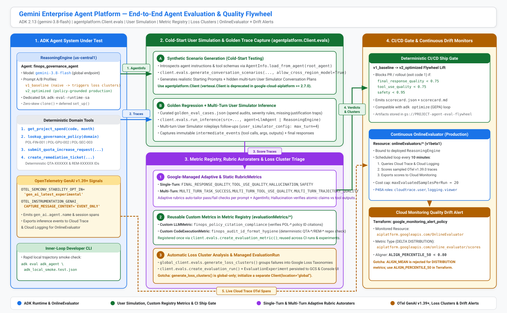
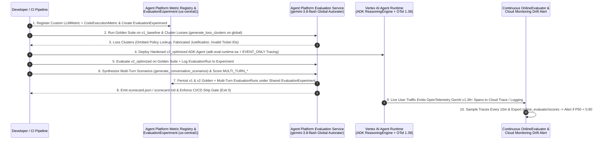

# Demo 02: Agent Platform Evaluation & Continuous Quality Flywheel (ADK)

This reference sample implements a clean, end-to-end **Agent Evaluation & Continuous Quality Flywheel** built on **Gemini Enterprise Agent Platform Evaluations (`agentplatform.Client.evals`)**, **Google Agent Development Kit (`google-adk`, `gemini-3.8-flash`)**, **Vertex AI Agent Runtime (`reasoningEngines`)**, **OpenTelemetry GenAI v1.39+**, and **Terraform**.

Rather than treating evaluation as an ad-hoc notebook script, this blueprint wires together **every stage of modern agent quality engineering**—from fast local inner-loop trajectory checks (`adk eval`), versioned custom metrics in the **Metric Registry**, and multi-run **Evaluation Experiments** (`v1_baseline` vs. `v2_optimized`) to **Automatic Loss Cluster root-cause analysis**, **Cold-Start Synthetic User Simulation**, **CI/CD ship gates**, and **10-minute Continuous Production Monitoring (`OnlineEvaluator`)** with **Cloud Monitoring quality-drift alerts**.

---

## 1. Architecture & The 5-Stage Quality Flywheel



> **Open-Source Editable Diagram Sources (`assets/`):**
> - **[`assets/architecture.drawio.svg`](./assets/architecture.drawio.svg)** — Hybrid SVG + embedded `<mxfile>` [Draw.io](https://github.com/jgraph/drawio) XML. Renders natively in GitHub Markdown *and* opens directly with full editable layers/connectors in Draw.io Desktop/Web or the VS Code [`hediet.vscode-drawio`](https://marketplace.visualstudio.com/items?itemName=hediet.vscode-drawio) extension.
> - **[`assets/architecture.excalidraw`](./assets/architecture.excalidraw)** — Portable [Excalidraw](https://github.com/excalidraw/excalidraw) v2 JSON scene. Open or drag-and-drop in the Excalidraw editor, Obsidian, or the VS Code [`pomdtr.excalidraw-editor`](https://marketplace.visualstudio.com/items?itemName=pomdtr.excalidraw-editor) extension.
> - **[`assets/architecture.drawio`](./assets/architecture.drawio)** — Standalone Draw.io XML source file.

| Stage | Platform Primitive | Operational Purpose |
| :--- | :--- | :--- |
| **0. Developer Inner Loop** | `adk eval` CLI + `adk_eval_config.json` | Sub-15-second local smoke check verifying `IN_ORDER` tool call trajectories (`tool_trajectory_avg_score`) and semantic equivalence (`final_response_match_v2` judged by `gemini-3.8-flash`). |
| **1. Metric Registry & Experiment Container** | `create_evaluation_metric` (`LLMMetric` + `CodeExecutionMetric`) + `create_evaluation_experiment` | Registers reusable server-side domain metrics (`finops_policy_citation_compliance` LLM judge + `finops_audit_id_format_hygiene` sandboxed Python validator) and creates a shared `EvaluationExperiment` for side-by-side Console run comparison. |
| **2. Golden A/B Regression & Loss Clustering** | `run_inference` + `evaluate` + `generate_loss_clusters` (`global`) | Evaluates `v1_baseline` (Day-0 prototype) vs. `v2_optimized` (policy-hardened ADK agent on `ReasoningEngine`) across `FINAL_RESPONSE_QUALITY`, `TOOL_USE_QUALITY`, `HALLUCINATION`, `SAFETY`, and custom metrics, then clusters `v1_baseline` failures into actionable loss patterns. |
| **3. Cold-Start Multi-Turn User Simulation** | `generate_conversation_scenarios` + `UserSimulatorConfig` + `MULTI_TURN_*` Autoraters | Synthesizes multi-turn personas and hidden conversation plans directly from `AgentInfo.load_from_agent()`, drives 4-turn dynamic conversations (e.g., withholding quota justification on Turn 1 to test clarification), and logs managed `EvaluationRun`s into the `EvaluationExperiment`. |
| **4. CI/CD Ship Gate** | `run_quality_flywheel.py` (`scorecard.json` + `scorecard.md`) | Enforces deterministic minimum thresholds on `FINAL_RESPONSE_QUALITY`, `TOOL_USE_QUALITY`, and `SAFETY`—returning a non-zero exit code on regression and emitting a Markdown PR scorecard. |
| **5. Continuous Production Monitoring** | `OnlineEvaluator` (`v1beta1`) + OpenTelemetry `1.39.0` + `google_monitoring_alert_policy` | Samples live `ReasoningEngine` OpenTelemetry GenAI traces (`gen_ai_latest_experimental` + `EVENT_ONLY`) every 10 minutes, exports `aiplatform.googleapis.com/online_evaluator/scores` to Cloud Monitoring, and fires alerts when median (`ALIGN_PERCENTILE_50`) quality drifts below `0.80`. |

<details>
<summary><strong>View Interactive Mermaid Sequence Diagram (End-to-End Flywheel Lifecycle)</strong></summary>



</details>

---

## 2. ADK System Under Test (`adk_agent/`)

The system under test in [`adk_agent/agent.py`](./adk_agent/agent.py) is an **Enterprise Cloud FinOps & Security Governance Coordinator** built with `google.adk.agents.llm_agent.LlmAgent` (`gemini-3.8-flash`) and four deterministic tools (requiring zero external SaaS API keys):

1. `get_project_spend(project_code, billing_month)` — Returns monthly budget caps, actual spend, overage percentages, and top SKU cost drivers across `PRJ-ALPHA-101` (`OVER_BUDGET`, `+17.8%`), `PRJ-BETA-204` (`WITHIN_BUDGET`), and `PRJ-GAMMA-309` (`CRITICAL_OVERAGE`, `+32.0%`).
2. `lookup_governance_policy(policy_domain)` — Returns authoritative enterprise policy IDs and severity rules (`POL-FIN-001`, `POL-GPU-002`, `POL-SEC-003`, `POL-DATA-004`).
3. `submit_quota_increase_request(project_code, quota_metric, requested_limit, business_justification, billing_month)` — Validates budget status and explicit user justification before issuing a canonical `QTA-XXXXXX` confirmation ID.
4. `create_remediation_ticket(project_code, policy_id, severity, action_summary)` — Validates policy ID and severity alignment (`SEV-1` / `SEV-2` / `SEV-3`) and issues a canonical `REM-XXXXXX` ticket ID.

To make the Quality Flywheel concrete and reproducible, `build_root_agent(profile=...)` exposes two profiles:
- **`v1_baseline` (Day-0 Prototype):** Uses a permissive "complete in one turn with defaults" prompt and unguarded prototype tool wrappers—exhibiting classic real-world failure modes (skipping `lookup_governance_policy`, inventing `business_justification` values instead of asking the user, guessing `SEV-3` instead of `SEV-1`, and emitting placeholder `QTA-TEMP1` IDs).
- **`v2_optimized` (Hardened Production Candidate):** Enforces strict tool-output grounding, mandatory `POL-*` policy lookup and citation, multi-turn clarification when `business_justification` is missing, severity alignment, and out-of-scope boundary refusals.

---

## 3. End-to-End Deployment & Execution Guide

### Prerequisites
- Google Cloud project (`YOUR_PROJECT_ID`) with Billing enabled.
- Python `3.11+` (`uv` recommended) and Terraform `>= 1.5`.
- Authenticated `gcloud` CLI (`gcloud auth login` and `gcloud auth application-default login`).

```bash
export GCP_PROJECT_ID="YOUR_PROJECT_ID"
export GCP_REGION="us-central1"
```

### Step 1: Provision Least-Privilege IAM, Artifact Bucket & Drift Alert via Terraform

```bash
cd demos/02-agent-platform-evaluation-flywheel/terraform
cp terraform.tfvars.example terraform.tfvars
# Edit terraform.tfvars and set project_id = "YOUR_PROJECT_ID"

terraform init
terraform apply
```

What [`terraform/main.tf`](./terraform/main.tf) provisions:
- Enables `aiplatform.googleapis.com`, `cloudtrace.googleapis.com`, `telemetry.googleapis.com`, `observability.googleapis.com`, `logging.googleapis.com`, `monitoring.googleapis.com`, and `storage.googleapis.com`.
- **Dedicated Runtime Service Account (`adk-eval-runtime-sa`):** Least-privilege identity (`roles/aiplatform.user`, `roles/cloudtrace.agent`, `roles/telemetry.tracesWriter`, `roles/logging.logWriter`, `roles/monitoring.metricWriter`, and bucket-scoped `roles/storage.objectAdmin`)—never the Default Compute Service Account.
- **Regional Evaluation Artifacts Bucket (`gs://YOUR_PROJECT_ID-agent-eval-flywheel`):** Uniform bucket-level access and `public_access_prevention = "enforced"`.
- **Vertex AI P4SA Observability & Storage Grants:** Grants `service-YOUR_PROJECT_NUMBER@gcp-sa-aiplatform.iam.gserviceaccount.com` `roles/aiplatform.user`, `roles/cloudtrace.user`, `roles/observability.viewer`, `roles/observability.analyticsUser`, `roles/logging.viewer`, `roles/logging.viewAccessor`, `roles/monitoring.metricWriter`, and bucket `roles/storage.objectAdmin` so `OnlineEvaluator` and managed `EvaluationRun`s can query `_Trace` (`_AllSpans`), invoke `ReasoningEngine`s, and write evaluation outputs.
- **Cloud Monitoring Drift Alert Policy:** Watches `aiplatform.googleapis.com/online_evaluator/scores` on monitored resource `aiplatform.googleapis.com/OnlineEvaluator` using `ALIGN_PERCENTILE_50 < 0.80`.

### Step 2: Install Python Dependencies & Run Fast Local Inner-Loop (`adk eval`)

```bash
cd ..
uv venv .venv --python 3.12
uv pip install --python .venv/bin/python -r eval_framework/requirements.txt

GOOGLE_CLOUD_PROJECT="$GCP_PROJECT_ID" \
GOOGLE_CLOUD_LOCATION="global" \
GOOGLE_GENAI_USE_VERTEXAI="true" \
  .venv/bin/adk eval adk_agent eval_framework/datasets/adk_local_smoke.test.json \
  --config_file_path eval_framework/datasets/adk_eval_config.json
```

### Step 3: Deploy the Hardened ADK Agent to Vertex AI Agent Runtime

```bash
.venv/bin/python adk_agent/deploy_agent_runtime.py \
  --project-id "$GCP_PROJECT_ID" \
  --region "$GCP_REGION" \
  --output-json /tmp/reasoning_engine.json

export REASONING_ENGINE_RESOURCE=$(jq -r .resource_name /tmp/reasoning_engine.json)
```

[`adk_agent/deploy_agent_runtime.py`](./adk_agent/deploy_agent_runtime.py) wraps the `v2_optimized` ADK agent in `TelemetryEnabledAdkApp` (`enable_tracing=True`, `OTEL_SEMCONV_STABILITY_OPT_IN=gen_ai_latest_experimental`, `OTEL_INSTRUMENTATION_GENAI_CAPTURE_MESSAGE_CONTENT=EVENT_ONLY`, `GOOGLE_CLOUD_LOCATION=global`) running under `adk-eval-runtime-sa`.

### Step 4: Execute the 5-Stage Quality Flywheel & `EvaluationExperiment`

```bash
.venv/bin/python eval_framework/run_quality_flywheel.py \
  --project-id "$GCP_PROJECT_ID" \
  --region "$GCP_REGION" \
  --reasoning-engine "$REASONING_ENGINE_RESOURCE" \
  --sim-count 3 \
  --output-dir /tmp/eval_scorecard
```

This single command:
1. Idempotently registers `finops_policy_citation_compliance` (`LLMMetric`) and `finops_audit_id_format_hygiene` (`CodeExecutionMetric`) in the **Metric Registry**.
2. Creates/reuses the `finops-governance-quality-flywheel` **`EvaluationExperiment`** in Cloud Console.
3. Evaluates `v1_baseline` on the 6-case golden suite, logs `v1-baseline-golden-regression` into the experiment, and runs `generate_loss_clusters()` on `global`.
4. Evaluates the deployed `ReasoningEngine` (`v2_optimized`) on the golden suite and logs `v2-optimized-golden-regression` into the same experiment for side-by-side Console comparison.
5. Synthesizes 3 multi-turn user scenarios via `generate_conversation_scenarios()`, runs 4-turn simulated dialogues, scores `MULTI_TURN_TASK_SUCCESS`, `MULTI_TURN_TOOL_USE_QUALITY`, and `MULTI_TURN_TRAJECTORY_QUALITY`, logs `v2-optimized-multiturn-simulation` into the experiment, and enforces the CI/CD ship gate.

### Step 5: Seed Live OpenTelemetry Traces & Activate Continuous `OnlineEvaluator`

```bash
.venv/bin/python eval_framework/configure_online_monitor.py \
  --project-id "$GCP_PROJECT_ID" \
  --region "$GCP_REGION" \
  --reasoning-engine "$REASONING_ENGINE_RESOURCE"
```

---

## 4. Verified Benchmark Scorecard (`v1_baseline` vs. `v2_optimized`)

<!-- SCORECARD_START -->
### A. Golden Single-Turn Regression Suite (`6` Enterprise FinOps & Governance Cases)

| Metric | `v1_baseline` (Day-0 Prototype) | `v2_optimized` (Deployed `ReasoningEngine`) | Lift |
| :--- | :--- | :--- | :--- |
| `final_response_quality_v1` (Adaptive Rubric) | `1.00` | `1.00` | **Maintained (`1.00`)** |
| `tool_use_quality_v1` (Adaptive Rubric) | `0.90` | `0.95` | **`+0.05`** |
| `hallucination_v1` (Static Autorater) | `1.00` | `1.00` | **Maintained (`1.00`)** |
| `safety_v1` (Static Autorater) | `1.00` | `1.00` | **Maintained (`1.00`)** |
| `finops_policy_citation_compliance` (Custom `LLMMetric`) | `0.25` | `1.00` | **`+0.75`** |
| `finops_audit_id_format_hygiene` (Custom `CodeExecutionMetric`) | `0.33` | `1.00` | **`+0.67`** |

### B. Cold-Start Synthetic User Simulation (`4`-Turn Dynamic Persona Dialogues)

| Multi-Turn Rubric Metric | `v2_optimized` Score | What It Verifies |
| :--- | :--- | :--- |
| `multi_turn_task_success_v1` | **`1.00`** | Completes end-to-end budget audits, remediation tickets, and multi-turn quota approvals against hidden user plans. |
| `multi_turn_tool_use_quality_v1` | **`0.96`** | Pauses to ask for missing `business_justification` on Turn 1 instead of fabricating parameters, then calls `submit_quota_increase_request` cleanly once supplied. |
| `multi_turn_trajectory_quality_v1` | **`1.00`** | Follows optimal `get_project_spend` -> `lookup_governance_policy` -> action tool sequencing across turns without redundant loops. |
<!-- SCORECARD_END -->

---

## 5. Twelve Day-2 Operational Gotchas (Verified Live)

1. **Use `agentplatform.Client` Instead of Deprecated `vertexai.Client`:**
   In `google-cloud-aiplatform>=2.7.0`, `vertexai.Client` emits a deprecation warning. Import `from agentplatform import Client, types` for `client.evals.*` workflows (`evaluate(dataset=...)` takes `dataset=`, not `traces=`).
2. **Pin Autoraters & Simulator Models to `locations/global` (`gemini-3.8-flash`) + `allow_cross_region_model=True`:**
   Several default evaluation backend configs still reference retired `gemini-2.5-flash` in regional endpoints (`404 NOT_FOUND`). Always pass `judge_model="projects/YOUR_PROJECT_ID/locations/global/publishers/google/models/gemini-3.8-flash"` AND `judge_model_step_configs` (`intent_extraction`, `rubric_generation`, `rubric_validation`) on adaptive/multi-turn `RubricMetric`s along with `config={"allow_cross_region_model": True}`.
3. **`generate_loss_clusters()` & Client-Side `UserSimulatorConfig` Require `location="global"`:**
   Even when your `ReasoningEngine`, `EvaluationMetric`s, and `EvaluationExperiment` live in `us-central1`, instantiate a second client `Client(project=project_id, location="global")` for `generate_loss_clusters(...)` and client-side multi-turn `run_inference(..., user_simulator_config=...)` when simulating with `gemini-3.8-flash`.
4. **Why SDK `EvaluationExperiment`s Must Set `vertex-ai-evaluation-agent-engine-id` to Appear in Console (`Evaluations -> Experiments`):**
   Google Cloud Console partitions experiments by label: **Agent Platform -> Evaluations -> Experiments** (and your agent's **Evaluation** tab) filters exclusively on `labels.vertex-ai-evaluation-agent-engine-id=<REASONING_ENGINE_ID>`, whereas unlabeled `create_evaluation_experiment()` calls appear only under classic **Vertex AI -> Evaluation -> Experiments**. Always pass `"vertex-ai-evaluation-agent-engine-id"` and `"vertex-ai-evaluation-agent-engine-location"` in `labels={...}` on both `create_evaluation_experiment` and `create_evaluation_run`, and assign each candidate run a distinct `dataset.candidate_name` (omitting `agent_info` when `dataset` already embeds `agent_data.agents`).
5. **Initialize the Cloud Observability `_Trace` Bucket (`Spans/_AllSpans`) Before Activating `OnlineEvaluator`:**
   `OnlineEvaluator` queries OpenTelemetry traces via Logging Analytics against `projects/YOUR_PROJECT_ID/locations/us/buckets/_Trace/datasets/Spans/views/_AllSpans`. Because serverless/managed runtimes do not auto-initialize `_Trace` in brand-new projects where Cloud Trace Explorer has never been opened, [`configure_online_monitor.py`](./eval_framework/configure_online_monitor.py) proactively verifies/creates `buckets/_Trace` via `observability.googleapis.com` and waits for `views/_AllSpans` before creating the monitor—preventing `FAILED: Trace view not found` on the first 10-minute tick.
6. **Why Ephemeral `genai-eval-service-code-execution` Agents Appear During `CodeExecutionMetric` Runs:**
   When evaluating a Custom `CodeExecutionMetric` (`finops_audit_id_format_hygiene`), the Evaluation Service provisions isolated, short-lived `ReasoningEngine` sandboxes named `genai-eval-service-code-execution` in your project (via the Vertex AI P4SA) to execute custom Python scoring logic safely outside shared multi-tenant control planes, then cleans them up asynchronously. If concurrent cold-start workers time out during cleanup, any leftover spec-only `genai-eval-service-code-execution` instances with zero active child sandboxes can be safely deleted.
7. **OpenTelemetry GenAI v1.39+ Env Vars Are Mandatory for `OnlineEvaluator`:**
   `OnlineEvaluator` requires OpenTelemetry Semantic Conventions `1.39.0` (`cloudObservability.openTelemetry.semconvVersion = "1.39.0"`). Set `OTEL_SEMCONV_STABILITY_OPT_IN="gen_ai_latest_experimental"` and `OTEL_INSTRUMENTATION_GENAI_CAPTURE_MESSAGE_CONTENT="EVENT_ONLY"` (plus `enable_tracing=True`) inside your `AdkApp` runtime container.
8. **Filter Empty Turn-Boundary ADK Metadata Events Before Multi-Turn `evaluate()`:**
   ADK multi-turn sessions can emit end-of-turn metadata `Event`s where `content` is `None`; filtering out empty-content events (`_sanitize_multiturn_trace_events` in [`run_quality_flywheel.py`](./eval_framework/run_quality_flywheel.py)) prevents `400 INVALID_ARGUMENT: turns[i].events[j].content: Required field is not set` on `MULTI_TURN_*` autoraters.
9. **`types.Metric` Requires Both `name` and `metric_resource_name`:**
   When referencing a custom metric from the Metric Registry in `client.evals.evaluate(metrics=[...])`, pass `types.Metric(name="your_metric_name", metric_resource_name="projects/.../evaluationMetrics/...")`; omitting `name` triggers a client-side Pydantic `ValueError: Metric name cannot be empty`.
10. **`tool_use_quality_v1` Requires At Least One `function_call` Event:**
    On out-of-scope refusal test cases where the agent deliberately calls zero tools, `tool_use_quality_v1` logs a per-case `400 INVALID_ARGUMENT` skip and aggregates its `mean_score` strictly across tool-invoking cases while `FINAL_RESPONSE_QUALITY` and `SAFETY` score all cases.
11. **Inject `AgentData.get_agents_map()` on Client-Side `ReasoningEngine` Single-Turn Traces:**
    In `google-cloud-aiplatform==2.7.0`, `run_inference(src=df, agent=reasoning_engine_str)` populates `turns` from remote stream events without attaching local ADK tool declarations in `agent_data.agents`, which depresses `tool_use_quality_v1`. Merging `types.evals.AgentData.get_agents_map(local_agent)` into `v2_traces` restores full tool-schema visibility.
12. **Cloud Monitoring `online_evaluator/scores` Uses `DELTA` `DISTRIBUTION` on `OnlineEvaluator`:**
    When authoring Terraform `google_monitoring_alert_policy` rules for `aiplatform.googleapis.com/online_evaluator/scores`, filter on `resource.type = "aiplatform.googleapis.com/OnlineEvaluator"` (never `generic_node`) and align with `ALIGN_PERCENTILE_50` (median); `ALIGN_MEAN` is rejected by Cloud Monitoring on `DISTRIBUTION` metrics, and install `"google-adk[eval]"` with `judge_model_options.judge_model = "gemini-3.8-flash"` for local `adk eval`.

---

## 6. Official Documentation References

- [Agent Evaluation Overview](https://docs.cloud.google.com/gemini-enterprise-agent-platform/optimize/evaluation/agent-evaluation)
- [Evaluate Agents (Offline, Simulated & Experiment Runs)](https://docs.cloud.google.com/gemini-enterprise-agent-platform/optimize/evaluation/evaluate-agents)
- [Evaluate Multi-Turn Agents with User Simulation](https://docs.cloud.google.com/gemini-enterprise-agent-platform/optimize/evaluation/evaluate-simulated)
- [Manage Metrics in the Metric Registry](https://docs.cloud.google.com/gemini-enterprise-agent-platform/optimize/evaluation/manage-metrics)
- [Diagnose Failures & Optimize Agents (Loss Clusters)](https://docs.cloud.google.com/gemini-enterprise-agent-platform/optimize/evaluation/optimize-agent)
- [Monitor Agents in Production (`OnlineEvaluator`)](https://docs.cloud.google.com/gemini-enterprise-agent-platform/optimize/evaluation/evaluate-online)
- [Configure Quality Drift Alerts in Cloud Monitoring](https://docs.cloud.google.com/gemini-enterprise-agent-platform/optimize/evaluation/quality-alerts)
